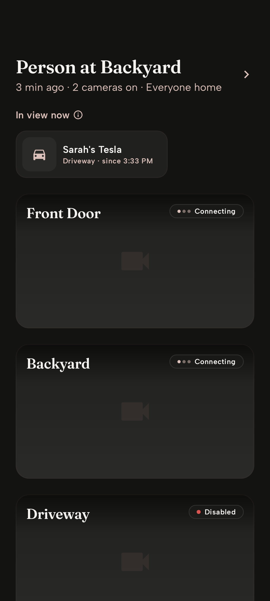

# UI previews of `claude/remove-home-summary` at `47bf175`

Compared with `main` at `849b07b`, their merge base. Drawn by [the UI previews workflow](https://github.com/aglose/HomeSafe/actions/runs/39058559564); see docs/ui-previews.md.

## Android

Drawn by Layoutlib, through Compose Preview Screenshot Testing (`:androidApp`'s `@PreviewTest`s). 6 changed · 0 new · 0 removed · 1 unchanged.

### HomeFeedAway · Home, everyone away (changed)

| Before | After |
|---|---|
|  |  |

### HomeFeedEmpty · Home, no cameras (changed)

| Before | After |
|---|---|
|  |  |

### HomeFeedIndoor · Home, indoor cameras (changed)

| Before | After |
|---|---|
|  |  |

### HomeFeedLoading · Home, loading (changed)

| Before | After |
|---|---|
|  |  |

### HomeFeedWithIndoor · Home, with indoor cameras (changed)

| Before | After |
|---|---|
|  |  |

### HomeFeed · Home (changed)

| Before | After |
|---|---|
|  |  |

### StatusBadges · Status badges

